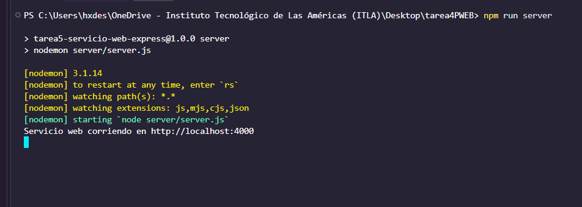
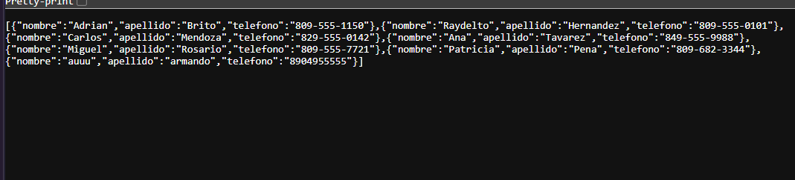

# Tarea 5: Servicio Web

**Estudiante:** Adrian Brito Nelkitts  
**Matrícula:** 20251150  
**Materia:** Programación Web  
**Profesor:** Raydelto Hernández  

---

## 📸 Evidencias de Ejecución

### 1. Servidor Express en ejecución


### 2. Petición GET al Servicio Web (JSON de contactos)


---

## Descripción

Servicio Web desarrollado con **Node.js** y **Express** que implementa las dos operaciones básicas del servicio `http://www.raydelto.org/agenda.php`:

1. **Listar contactos (`GET /contactos`):** Retorna en formato JSON la lista completa de contactos almacenados (`nombre`, `apellido`, `telefono`).
2. **Almacenar contactos (`POST /contactos`):** Recibe un objeto JSON con los campos `nombre`, `apellido` y `telefono`, valida los datos y guarda el nuevo registro en el servidor.

---

## Estructura del Proyecto

- `server/server.js`: Configuración principal del servidor Express, CORS y rutas del servicio web.
- `server/routes/contactos.js`: Definición de los endpoints `GET` y `POST`.
- `server/controllers/contactosController.js`: Lógica para listar y almacenar contactos en `server/data/contacts.json`.
- `client/`: Interfaz en React conectada al servicio web local (`http://localhost:4000/contactos`) para probar el listado y registro de contactos.

---

## Ejecución

1. **Instalar dependencias:**
   ```bash
   npm install
   cd client && npm install && cd ..
   ```

2. **Iniciar el servicio web Express:**
   ```bash
   npm run server
   ```
   El servicio estará disponible en `http://localhost:4000/contactos` (también accesible en `http://localhost:4000/` y `http://localhost:4000/agenda.php`).

3. **Iniciar servidor y cliente simultáneamente:**
   ```bash
   npm run dev
   ```
